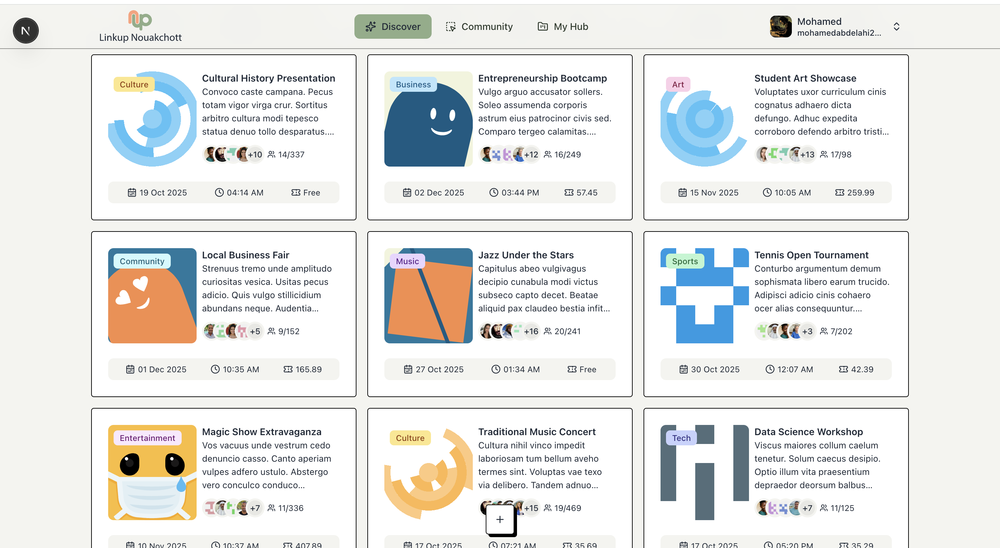

# Linkup Nouakchott

A community events platform for discovering local gatherings, hosting events, and registering for free tickets. Built with Next.js, React, TypeScript, Prisma, and PostgreSQL.



## Features

- Discover events and community posts in English or French.
- Create events with capacity, registration deadlines, and organizer contact details.
- Register for free and receive a QR ticket immediately.
- Check in attendees with organizer-only ticket scanning.
- Manage hosted events, registrations, saved items, and notifications.
- Moderate users, events, and community posts through an admin dashboard.
- Install the app as a PWA, with a lightweight offline page and optional push notifications.

There is no checkout or payment confirmation flow. Historical price fields remain in the database for compatibility; event creation and updates always use free admission.

## Local setup

Use Node.js 24 LTS, npm, a Neon PostgreSQL database, and a Kinde application.

```sh
npm ci
cp .env.example .env
# Configure Neon and Kinde before starting the app.
npm run db:generate
npm run db:migrate
npm run dev
```

The runtime uses the Neon WebSocket adapter. A plain local PostgreSQL server requires a compatible proxy or a different Prisma adapter.

In Kinde, allow `http://localhost:3000/api/auth/kinde_callback` as a callback and `http://localhost:3000` as a logout redirect. Set the post-login destination to `/api/auth/session` so the authenticated profile is synchronized into the application database.

Email, push notifications, Sentry uploads, and PostHog analytics are optional. Registration still returns an in-app ticket if email delivery fails.

For disposable development data only:

```sh
npm run db:seed
```

The seed adds synthetic users and events; do not run it against production.

## Structure

```text
src/app/          Route files, layouts, and application providers
src/features/     Domain modules: events, tickets, community, manage, admin, users
  <feature>/
    actions/      Authenticated server entry points
    components/   Feature UI
    server/       Internal transactional workflows, where needed
    schemas/      Input validation, where needed
src/server/       Server-only errors, transactions, email, push, and public data projections
src/components/   Shared UI and layout components
src/lib/          Auth, database, logging, and browser-safe utilities
src/types/        Shared domain types
prisma/           Schema, versioned migrations, and development seed
public/           Media, manifest, service worker, and offline page
tests/            Registration, check-in, validation, and redirect regression tests
```

## Checks

```sh
npm run lint
npm run typecheck
npm test
npm run format:check
npm run build
```

Generate Prisma Client before type checking a fresh checkout. Tests mock the database and external services; full OAuth, camera, email, push, and database integration checks require a configured development environment.

Builds do not apply database migrations. Run `npm run db:migrate` separately during a deployment that changes the schema.

See [architecture](docs/architecture.md) and [domain configuration](docs/domain-configuration.md).

## Temporary guest access

Choose **Try as a guest** above the public page content. Each visitor receives a separate ordinary user account and an opaque, HttpOnly session cookie lasting 24 hours. Only a SHA-256 token digest is stored in `guest_sessions`; no public account password is shared. Existing Kinde login takes precedence. Guest activity does not transfer into a Kinde account.

Guests can browse, save favorites and use participant features. Publishing events/community posts and uploading files require Kinde sign-in. Guests have no administrator privileges. Guest ticket email is skipped because a guest has no verified email address. Ending the session invalidates it immediately; expired session digests remain available to enforce the creation limit of five sessions per IP per hour. User and registration records remain so existing tickets and event history are preserved.

Before deploying, apply `20261109000100_guest_sessions` with `npx prisma migrate deploy`. Configure `KINDE_SITE_URL` to the public app origin; guest mutations reject missing/foreign Origin headers. Production uses Vercel's trusted forwarding header for the IP limit. Session/API responses and document navigations bypass the service worker cache.

## Deployment status

The live app is available at [linkup-nouakchott.vercel.app](https://linkup-nouakchott.vercel.app/en). The repository contains the newer architecture refactor; the existing production deployment remains on its verified guest-access revision. Git-triggered Vercel deployments are disabled in `vercel.json` so publishing repository updates does not replace that live version. Deployments are manual until the refactor is scheduled for release.
